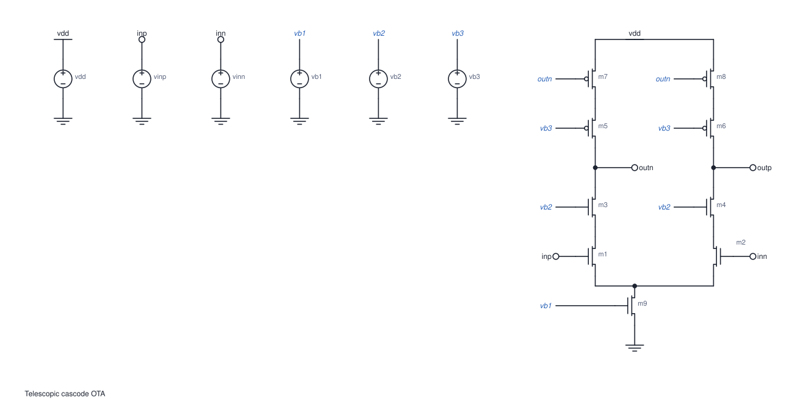
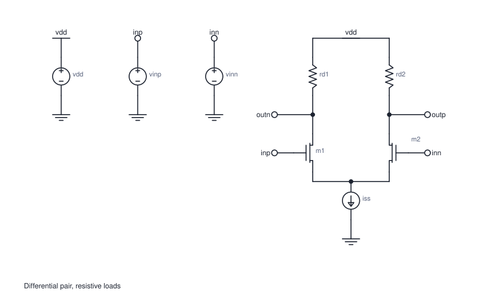
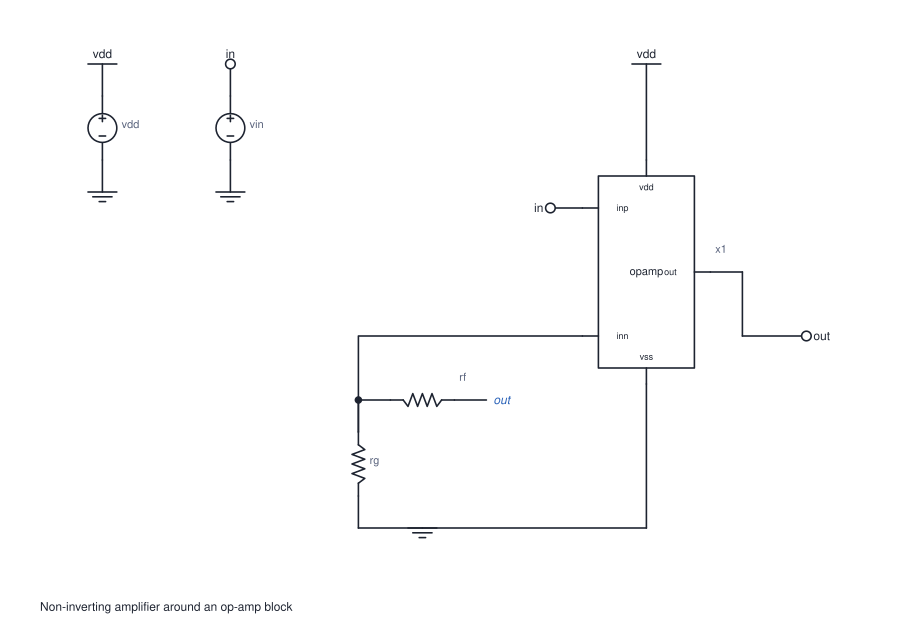

# cktImg

[](https://github.com/OmarSiwy/cktImg/actions/workflows/ci.yml)
[](https://github.com/OmarSiwy/cktImg/releases/latest)
[](https://ziglang.org/download/)
[](https://omarsiwy.github.io/cktImg/)
[](LICENSE)

**Turn a SPICE netlist into a clean, textbook-style schematic. You don't
draw anything.**

Give it the `.cir`/`.spice` file you already simulate with. You get back a
schematic laid out the way a textbook draws it: supply at the top, ground at
the bottom, signal flowing left to right, mirrored branches lined up. Use it
for a figure in your paper, open it in xschem, or feed it to your own
schematic editor.


## Contents

- [I want a figure for my paper](#i-want-a-figure-for-my-paper)
- [I want to open it in xschem](#i-want-to-open-it-in-xschem)
- [I want it in my own editor (Virtuoso, KiCad, …)](#i-want-it-in-my-own-editor-virtuoso-kicad-)
- [Gallery](#gallery)
- [For developers](#for-developers)

## Download

Get the latest build from
[**Releases**](https://github.com/OmarSiwy/cktImg/releases/latest).
Nothing needs installing: each tool is a single file, and you pick the one
for your computer:

| your computer | file suffix |
|---|---|
| Windows | `-x86_64-windows.exe` |
| Mac (Apple silicon, M1 or later) | `-aarch64-macos` |
| Mac (Intel) | `-x86_64-macos` |
| Linux | `-x86_64-linux` |

On Mac and Linux, allow the file to run once with `chmod +x <file>`. On a
Mac, you may also need to right-click it and choose **Open** the first time.

## I want a figure for my paper

### In LaTeX (pdflatex, Overleaf, …)

1. Download **`cktimg-latex.zip`** from Releases and unzip it.
2. Copy `cktimg.sty` next to your `.tex` file, along with your netlist (say `amp.cir`).
3. In your document:

   ```latex
   \usepackage{cktimg}
   ...
   \begin{figure}
     \centering
     \cktimg{amp.cir}
     \caption{My amplifier.}
   \end{figure}
   ```

4. Compile with `pdflatex -shell-escape paper.tex`. The figure is drawn
   during the run and redrawn whenever you edit the netlist.

**On Overleaf**, or anywhere you can't use `-shell-escape`, draw the figure
once on your own computer and upload the result next to the netlist:

```sh
cktimg-tex amp.cir amp.cktimg.tex
```

`\cktimg{amp.cir}` then uses `amp.cktimg.tex`. The figure is plain TikZ
(CircuiTikZ), so it takes your document's fonts and you can edit it by hand.
`cktimg-latex.zip` includes a complete worked example in `examples/`.

### As an image (Word, PowerPoint, slides, a website)

```sh
cktimg-json --svg amp.svg amp.cir > /dev/null
```

`amp.svg` opens in any browser and can be inserted into Word or PowerPoint
directly. For a PDF or PNG, open it in Inkscape and export.

## I want to open it in xschem

```sh
cktimg-xschem amp.cir amp.sch
xschem amp.sch
```

You get a real xschem schematic made from xschem's own symbols, not a
picture: every device is an instance, every wire a wire, and every net keeps
its name, so you can keep editing and simulating it. Each change to this
project is checked by having xschem netlist every gallery drawing back and
comparing its nets with the original.

## I want it in my own editor (Virtuoso, KiCad, …)

cktImg does the hard part, deciding where every device, wire and label goes.
Your editor only has to draw the result. There are two ways in:

**Without writing C: the JSON route.** Write a small manifest that maps
cktImg's device classes to your library's symbols and pin order:

```json
{
  "target": "virtuoso", "version": 1,
  "unmapped": { "mode": "box", "sym": "basic/generic" },
  "classes": {
    "nmos": { "sym": "analogLib/nmos4" },
    "res":  { "sym": "analogLib/res", "pins": ["a", "b"] }
  }
}
```

`pins` lists cktImg's terminal names in the order your symbol numbers its
pins.

```sh
cktimg-json --target virtuoso.json amp.cir amp.json
```

`amp.json` lists each device with its symbol, position and rotation, the
point of every pin, the wires as polylines, junction dots and net labels.
The script that reads it is the only editor-specific part: SKILL in
Virtuoso (`dbCreateInst`, `schCreateWire`, …), Python in KiCad, and so on.
There is no Virtuoso script in this repo yet. The xschem exporter
(`tools/xschem/export.zig`) is a complete backend you can model one on. The manifest format is described in
[`docs/TARGETS.md`](docs/TARGETS.md).

**Linking it in: the C route.** `libcktimg.a` with `include/cktimg.h` is a
plain C library with no dependencies, built for Linux, macOS, Windows and
WebAssembly. Your code describes your symbols (pins and outlines), passes in
the netlist, and reads back positions, pins, wires, junctions and labels.
See [`docs/API.md`](docs/API.md#8-from-c).

## Gallery

All of these were drawn by cktImg straight from their netlists, without any
hand edits (`zig build gallery -- --svgs out/` regenerates them).

**Telescopic cascode OTA.** Two stacked columns of five transistors that stay
level, with bias lines as labels.



**Two-stage Miller op-amp.** Mirror load, tail source, second stage and
the compensation capacitor across it.


**Five-transistor OTA.**


**Sallen-Key low-pass with a unity-gain buffer.** The feedback capacitor's
far end is named `out` rather than routed around the op-amp.


**Differential pair with resistive loads.**



**A `.subckt` as a block.** It's the op-amp below, drawn with its ports
placed as the `*@` comments say.



The bandgap at the top has three mirrored PMOS branches with an op-amp
between the first two. Its shared gate line `g` is a label, because wiring it
would have to cross the branches.

## For developers

The output is geometry: devices at integer points with an orientation,
every pin's point, wires as polylines per net, junction dots, net labels and
no-connect marks. The library itself draws nothing and knows no devices. The
application describes each device class (terminal anchors and body strokes)
and turns the result into its own format. See [`docs/API.md`](docs/API.md),
and [`ALGORITHM.md`](ALGORITHM.md) for how placement works.

```zig
const np = @import("NetlistParser");

var lib = np.Library.init(gpa);                 // your symbols
defer lib.deinit();
try lib.loadZon(arena, symbols_zon, &diags);    // e.g. tests/symbols.zon

var placed = try np.place(gpa, &np.Config.default, &lib, &.{spice_text}, &diag);
defer placed.deinit();
// placed.dev_pos, .dev_orient, .pin_xy, .segments(net), .junctions, .labels, …
```

### Install

**Zig** (0.17.0). The package and module are named `NetlistParser`:

```sh
zig fetch --save git+https://github.com/OmarSiwy/cktImg#v1.0.0
```

```zig
// build.zig
const np = b.dependency("NetlistParser", .{ .target = target, .optimize = optimize });
exe.root_module.addImport("NetlistParser", np.module("NetlistParser"));
```

**C.** `zig build lib` gives you `zig-out/lib/libcktimg.a` and
`zig-out/include/cktimg.h`. Add `-Dtarget=…` to cross-compile for another
target. Prebuilt archives for each platform are attached to every release.

### Subcircuits

An `X` instance of a `.subckt` in the netlist is one block, drawn with your
class of that name or a generated box. Comments in the definition steer it:

```spice
.subckt opamp inp inn out vdd vss
*@ left inp inn        (also right / top / bottom)
*@ right out
...
.ends
```

`*@ expand` draws the body instead, flattened with ngspice names (`r.x1.r1`).

An `X` whose master is not defined in the deck is still drawn: a PDK
primitive (`XM1 d g s b sky130_fd_pr__nfet_01v8`, `…res…`, `…cap…`) as that
device, anything else as a block with ports `p1`..`pN`.

### Build

Zig 0.17.0.

```sh
zig build                             # libcktimg.a + include/cktimg.h + the gallery tool
zig build lib                         # only libcktimg.a + include/cktimg.h (-Dtarget=wasm32-freestanding too; -Dpic=true for a PIE host)
zig build lib -Dzon_config=false     # a C ABI that refuses settings and .zon symbol files, without the ZON parser (smaller wasm)
zig build test                        # library, algorithm, API and C ABI tests
zig build -Dlatex_renderer=true       # also cktimg-tex and the TikZ emitter
zig build gallery -- --svgs out/      # the textbook circuits as SVG
zig build gallery -- --config lint.zon in.cir out.svg
zig build fuzz                        # 4000 random netlists; smallest example per rare case
```

### Command line

```sh
cktimg-json [--config lint.zon] [--target manifest.json] [--svg out.svg] deck.spice [out.json]
```

The placed schematic as JSON (`src/json.zig` has the shape), optionally
with a `"target"` block mapping classes and subcircuit names to a backend's
symbols (`docs/TARGETS.md`), and drawn as SVG. A file of only `.subckt`
definitions draws its last one. `examples/blocks.spice` is a hierarchical
deck to try it on.

### Layout

- `src/` — the library: `netlist.zig` (parser), `schematic.zig` and
  `layout.zig` (the algorithm, specified in `ALGORITHM.md`), `placed.zig`
  (the result), `library.zig` (device classes), `config.zig` (`lint.zon`),
  `lint.zig`, `geom.zig`, `latex.zig`, `json.zig`, `abi.zig` (the C ABI).
- `include/cktimg.h` — the C header.
- `tests/` — the tests, the tests' symbol set (`symbols.zon`), an SVG
  renderer and the gallery, all on the public API.
- `tools/json.zig` — `cktimg-json`; `tools/tex.zig` — `cktimg-tex`, which writes CircuiTikZ;
  `latex/cktimg.sty` — the LaTeX package (loads `circuitikz`).
- `tools/xschem/` — the xschem target: `cktimg-xschem in.cir out.sch`,
  its symbol set and mapping (`symbols.zon`, `xschem.zon`, regenerated from
  xschem's library by `gen_symbols.py`), and `roundtrip.py`, which checks
  that xschem netlists the drawing back to the input's nets.
- `lint.zon` — every setting, with its default.

## License

MIT. See `LICENSE`.
