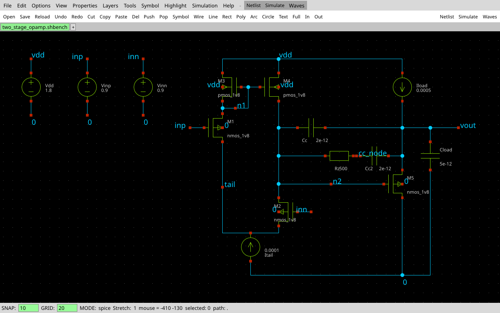

# cktImg

[](https://github.com/OmarSiwy/cktImg/actions/workflows/ci.yml)
[](LICENSE)

**A [Schemify](https://github.com/OmarSiwy/Schemify) plugin that imports a SPICE netlist as
schematics you can keep editing.** Supplies at the top, grounds at the bottom, signal left to
right, sources that drive a supply or an input drawn apart on the left between their terminal
symbols, and a net name wherever a wire would cross the circuit. The plugin maps every device
onto a Schemify `core` cell (or a generated one), tells the layout engine the pin geometry of
those cells, and writes its placement as Schemify records. Each `.subckt` becomes a `.shcomp`,
a top level (devices, sources, analyses, `.control` blocks) becomes a `.shbench`. The files
netlist to the same circuit: the tests check every fixture through Schemify's `elab`, its
netlister and `spicecmp`.



The layout engine is a Zig library with a C ABI in [`engine/`](engine/README.md). It is also
usable on its own (the secondary interface): LaTeX/TikZ figures, SVG and JSON from
`cktimg-tex` and `cktimg-json`, and `libcktimg.a` for your own editor. See
[engine/README.md](engine/README.md).

## Install

In your Schemify config (`init.lua`), add the package from this repository; it ships
`cktimg.wasm` and a `schemify.project` that requests the two grants below:

```lua
schemify.pack.add({
  { src = "https://github.com/OmarSiwy/cktImg", name = "cktimg",
    grant = { "read_project", "write_project" }, fuel = 100000000000 },
})
```

Then `schemify pack sync` (pin a commit with `rev = "<sha>"`; the lockfile records it).
A single project can instead load a checked-out copy from its manifest, as below.

## Usage

Or add the plugin to one project's manifest and grant it file access:

```
plugin cktimg path plugins/cktImg/cktimg.wasm
  grant read_project
  grant write_project
  fuel 100000000000
```

The `fuel` line is optional: it raises the plugin's budget per event from the default 10^8
so that large flat cells lay out (see Limits).

Then use **File ▸ Import SPICE netlist…** or `Ctrl+Shift+I`. A panel asks for a
project-relative path (`.sp`, `.cir` or `.spice`); press Enter to import. The command also takes
the path as its argument (`cktimg.import n2s/opamp.sp`).

The files are written next to the netlist: `<subckt>.shcomp` for each subckt, `<file>.shbench`
for the top level (`<file>_2` when a subckt has the same name), and the generated leaf cells
described below. The log reports cells, devices, wires, labels, how many nets are fully wired,
and every line it kept as code or changed.

| Capability | Why |
|---|---|
| `read_project` | read the netlist; check whether output names exist |
| `write_project` | write the new cells |

The plugin never overwrites. If any output cell already exists, nothing is written and the log
names the files in the way. Generated leaves (`spice_*.shprim`, stubs) that already exist are kept,
since earlier imports into the same directory share them.

## What becomes what

| SPICE | Schemify |
|---|---|
| `R C L V I E G F H S W T`, `M` with literal `w`/`l`, `D`/`Q` with `area=` | instance of `core:res`, `core:nmos4`, … (pins in SPICE order, values as overrides) |
| any other card, e.g. `D1 a k dmod` (the core diode always prints `area=`), `J`, `B`, behavioural `E`/`G`, 4-node `Q` | instance of a generated leaf `spice_<kind>.shprim` whose template `{name} {pins} {args}` re-emits the card verbatim |
| XSPICE `A` (`A1 [a b] ~y nand1`, `%v`/`%vd(…)` modifiers, `null`) | instance of a leaf box `spice_a<n>` (every node but the last an input); a card with vectors or modifiers gets a leaf of its own port shape, `spice_a<n>_<hash>`, whose template puts each node back in its place (`{name} [{p1} {p2}] ~{p3} {args}`) |
| `N` (OSDI devices), `P` (coupled lines), `Y` (lossy lines): nodes, then the model | instance of a leaf `spice_n4`, `spice_p6`, …, card re-emitted |
| `X` of a subckt in the file | instance of `./<subckt>`; call parameters become overrides |
| `X` of an undefined subckt (PDK device, external DUT) | instance of a stub leaf named after it, `X…` card re-emitted |
| `X` with no nodes (`X1 sub`: a subckt on globals only) | the same, placed below the drawing (nothing to wire); a stub of an undefined subckt gets one placeholder pin, no-connected, that its template `{name} {args}` never prints |
| `*@ left/right/top/bottom <ports>` in a `.subckt` (cktImg's block directives) | the generated symbol's pins on those sides, in directive order; other ports: inputs left, the rest right |
| `.subckt` ports, params, in-body `.param` | `pin` + `port` records; `param` records (kind `string`), re-declared in the netlist by a `.param` line inside the definition; a repeated parameter keeps its later value |
| `.global` | labels with `global true` |
| top-level dot cards, `K`, `.control … .endc`, unsupported letters | the bench's `code netlist spice` block, verbatim |
| dot cards inside a subckt (`.model`, `.save`, …) | a `spice_code` instance inside the component, so they stay in its scope |

## How the layout is made

cktImg knows no devices; the plugin registers one class per symbol family (`res`, `nmos`,
`cvsource`, …, and `b<n>` for each generated box), with terminals at the Schemify pin
positions turned a quarter (cktImg's canonical frame has the principal pins on the x axis,
Schemify's cells are upright). A generated box puts its pins 20 apart,
centred on each side, far enough out that each faces its own side by cktImg's rule (the
larger of |x| and |y|): x = ±60 for up to six pins a side, wider beyond. One pin-to-pin length is 60, so cktImg's
integer grid is xschem units and every wire ends exactly on a pin. Each cell is handed to
cktImg as a deck of its own: one card per device, under the cell's own net names, so
cktImg's name rules (`vdd*` up, `gnd`/`vss*` down, `in*` left, `out*` right) see what the
designer wrote. Back from cktImg:

- an instance's orientation is cktImg's composed with the family's quarter turn; every pin
  is asserted to land where cktImg put it;
- wires are its polylines, one segment per record, overlaps cut at every end;
- its net labels, supply/ground/port symbols and a MOSFET's bulk (drawn on the symbol,
  never wired) become `label` records, the first on a subckt port's net the `port`;
- its no-connect crosses become `noconn`; junction dots are left to Schemify.

Every net of two or more pins carries its name (on a wire it alone uses, else on a pin), as
do ports, globals and nets the code text mentions, so `.control` text that names `v(out)`
still works. Ids and bytes are deterministic, natively and in the wasm guest.

## Limits

- **Fuel.** cktImg's layout is heavy for an interpreter: about 10^8 wasmi fuel per
  millisecond of native layout time. The import draws one cell per event (a 0 ms timer
  between cells, so the editor draws frames in between), and each event gets the plugin's
  whole budget. Under the default 10^8 the fixtures with a large flat cell (the `bus/*`
  decks, `sr_latch`, `phase_detector`, `raw_cards`) abort with `E_FUEL` and write nothing
  (`tests/guest.rs` lists them with their measured need, up to 4·10^10); the project
  manifest raises the budget for this plugin (`plugin cktimg path …/cktimg.wasm` with
  `fuel 100000000000`, the editor's ceiling), and then all but `bus_sram_cell_array` (one 117-device flat cell, over 10^11) import. Events still run on the
  editor's frame thread, so such a cell stalls the editor while it is drawn.
- At most 200 element cards per import; cktImg draws at most 120 devices per cell and 400
  per import (native time and memory guards, measured in the same document). Bigger cells
  are drawn in rows with every pin labelled, which stays correct.
- The first line is not a title. Start a netlist with `*` or `.title`.
- `K` cards, and `A`/`N`/`P`/`Y` cards with no node or no model, are kept as code in the
  cell they appear in. `*@ expand` is ignored: every subckt stays a cell of its own.
- Subckt parameters are `string` parameters. A literal `w`/`l` maps onto the core MOSFET;
  anything parametric goes through a `spice_*` leaf.
- A stray token on a `.subckt` line (`delay=200 ps`) is dropped with a warning.
- Node names containing `,`, `*` or `:` are renamed with `_`, since those characters mean
  bundle, repeat and range in a net expression.
- `cktimg.wasm` is ~515 KB, cktImg ~290 KB of it (built without its ZON settings parser);
  `build.sh` allows it 550 KB.

## Build

```sh
nix develop          # rustc, wasm-ld and Zig 0.17, pinned like Schemify's (flake.lock)
./build.sh           # cktimg.wasm, byte-reproducible; commit it with the source change
cargo test           # the native tests and the built guest through Schemify's real host
```

`build.rs` runs the engine's `zig build lib` in `engine/` (Zig 0.17: `nix develop`, or set
`ZIG`) for the cargo target: `wasm32-freestanding` ReleaseSmall with `-Dzon_config=false`
for the guest, the host ReleaseFast with `-Dpic=true` for the native tests, everything
inside `OUT_DIR`.

Schemify's crates (`schemify-abi`, and for the tests `doc`, `elab`, `run`, `plugin`,
`spicecmp`) are git dependencies pinned to one Schemify commit in `Cargo.toml`. To build
against a local Schemify checkout, add to `.cargo/config.toml` (not committed):

```toml
[patch."https://github.com/OmarSiwy/Schemify"]
schemify-abi = { path = "../Schemify/crates/abi" }
# … one line per schemify-* crate
```

CI (`.github/workflows/ci.yml`) runs the engine's Zig suite, the plugin's fmt, clippy and
tests, the fuel-ceiling guest test, and checks that the committed `cktimg.wasm` equals its
rebuild; `nightly.yml` runs the plugin tests against Schemify's `main`, so a core change
that breaks the plugin shows up within a day.

## Code

- `src/ffi.rs`: the safe wrapper over `engine/include/cktimg.h`, one method per C function; the
  crate's only `unsafe`.
- `src/spice.rs` (parse), `src/recognize.rs` (core-cell mapping, overrides, generated
  symbols), `src/layout.rs` (class library, per-cell decks, cktImg's result as Schemify
  geometry), `src/emit.rs` (records, ids), `src/plugin.rs` (command, panel, I/O job).

## Tests

`cargo test`:

- `tests/roundtrip.rs`: netlist → files → `doc` + `elab` + netlister → SPICE, compared with the
  input by `tools/spicecmp`, on the salvaged fixtures (`tests/fixtures/*/`), hand fixtures and,
  when `CKTIMG_CORPUS` points at a fetched corpus cache (the interop plugin's `corpus/`, the
  directory holding `golden/`), the xschem golden netlists (`--ignored`;
  `CKTIMG_CORPUS_FILTER` narrows them). The files oracle is a copy of the interop plugin's
  (`tests/common/check.rs`). It also checks that files load and
  round-trip, that no wires overlap, that every pin is wired or labelled, that output is
  deterministic and that mutated netlists never panic, and prints layout metrics.
- `tests/ffi.rs`: the wrapper against cktImg's invariants on its own symbol set (pins on their
  terminals, wire ends on their net, every net wired or named on every piece, same deck →
  same document, refusals as errors, mutated decks never panic).
- `tests/guest.rs`: the built `cktimg.wasm` (from `build.sh`) through the real host:
  contributions, the import flow (one timer event per cell, an abandoned job's timer
  ignored), wasm output byte-identical to native, the fuel aborts at the default budget
  and the same fixtures importing at the manifest's fuel ceiling (ignored by default; CI
  runs it with `cargo test --profile fuel … -- --ignored over_budget`), the no-overwrite
  refusal. `--ignored fuel_report` prints the fuel report (`CKTIMG_FUEL_FILTER`).

## License

[MIT](LICENSE)
