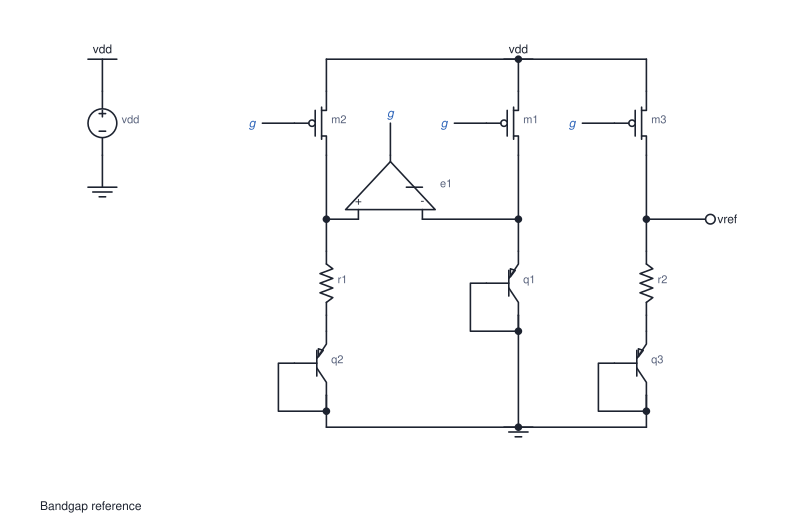
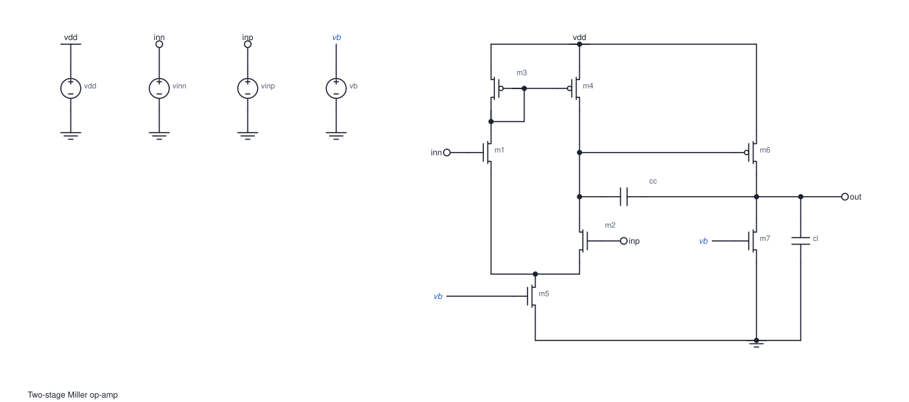
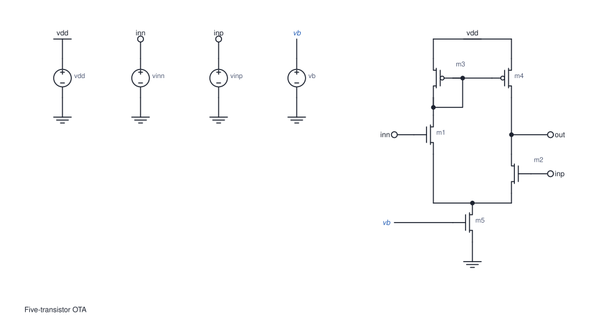
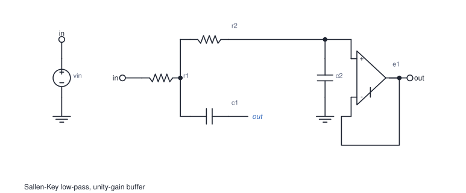

# cktImg

[](https://github.com/OmarSiwy/cktImg/actions/workflows/ci.yml)
[](https://github.com/OmarSiwy/cktImg/releases/latest)
[](https://ziglang.org/download/)
[](https://omarsiwy.github.io/cktImg/)
[](LICENSE)

**Automatic schematics from SPICE netlists.**

cktImg reads the netlist you already simulate and lays it out the way a
textbook would: supply at the top, ground at the bottom, signal flowing left
to right, and matched branches side by side. The result is a figure for your
paper, an editable schematic in [Schemify](https://github.com/OmarSiwy/Schemify)
(this repository's primary product, see the [root README](../README.md)), or
placement data for your own schematic editor.



- **No drawing.** Placement, wiring, junctions and net labels are all automatic.
- **Your symbols, not ours.** You decide what each device looks like and where
  its pins are, and wires land exactly on them. See [Defining devices](#defining-devices).
- **Many outputs.** LaTeX/TikZ, SVG, JSON, and a C library
  (also builds for WebAssembly).
- **Standalone.** Single-file tools with no runtime dependencies, for Linux,
  macOS and Windows.

## Contents

- [Download](#download)
- [Figures for a paper](#figures-for-a-paper)
- [Your own schematic editor](#your-own-schematic-editor)
- [Defining devices](#defining-devices)
- [Gallery](#gallery)
- [For developers](#for-developers)
- [Documentation](#documentation)

## Download

Every [release](https://github.com/OmarSiwy/cktImg/releases/latest) includes
the tools prebuilt. Each one is a single file, so there's nothing to install.
Choose the file whose name ends with your platform:

| Platform | Suffix |
|---|---|
| Windows | `-x86_64-windows.exe` |
| macOS, Apple silicon (M1 and later) | `-aarch64-macos` |
| macOS, Intel | `-x86_64-macos` |
| Linux | `-x86_64-linux` |

| Tool | Use it for |
|---|---|
| `cktimg-tex` | Figures in LaTeX (also in `cktimg-latex.zip`, with the LaTeX package) |
| `cktimg-json` | SVG images, and JSON for other editors |

On macOS and Linux, mark the file executable once with `chmod +x <file>`. On
macOS, the first time you open it you may need to right-click it and choose
**Open**.

## Figures for a paper

### LaTeX

1. Download **`cktimg-latex.zip`** and unzip it.
2. Put `cktimg.sty` and your netlist (for example `amp.cir`) next to your `.tex` file.
3. Add the figure:

   ```latex
   \usepackage{cktimg}
   % ...
   \begin{figure}
     \centering
     \cktimg{amp.cir}
     \caption{Two-stage amplifier.}
   \end{figure}
   ```

4. Compile with `pdflatex -shell-escape paper.tex`. Whenever the netlist
   changes, the figure is regenerated.

**Overleaf, and other setups without `-shell-escape`:** generate the figure
on your own computer and upload the result alongside the netlist.

```sh
cktimg-tex amp.cir amp.cktimg.tex
```

`\cktimg{amp.cir}` will then input `amp.cktimg.tex`. The figure is
[CircuiTikZ](https://ctan.org/pkg/circuitikz), so it uses your document's
fonts and can be edited by hand. A complete example is in
`cktimg-latex.zip` under `examples/`.

### Word, PowerPoint, or the web

```sh
cktimg-json --svg amp.svg amp.cir > /dev/null
```

`amp.svg` opens in any browser and can be inserted directly into Word or
PowerPoint. To get a PDF or PNG, export it from a vector editor such as
Inkscape.

## Your own schematic editor

cktImg decides where every device, pin, wire and label goes; your editor only
has to create them. That works for Virtuoso, KiCad, an in-house tool, or
anything else that can read a file or call C.

1. **Describe your editor's symbols** in a symbol file, giving each pin's
   position in your editor's coordinates (see [Defining devices](#defining-devices)).
   Wires are then guaranteed to land on your symbols' pins.
2. **Map device classes to your library's cells** in a small target manifest:

   ```json
   {
     "target": "virtuoso", "version": 1,
     "unmapped": { "mode": "box", "sym": "basic/generic" },
     "classes": {
       "nmos": { "sym": "analogLib/nmos4" },
       "res":  { "sym": "analogLib/res", "pins": ["a", "b"] }
     }
   }
   ```

   `pins` lists the terminal names from your symbol file, in the order your
   cell numbers its pins. The full format is in [`docs/TARGETS.md`](docs/TARGETS.md).
3. **Place:**

   ```sh
   cktimg-json --symbols virtuoso.zon --target virtuoso.json amp.cir amp.json
   ```

   `amp.json` gives each device's cell, position, rotation and mirroring,
   every pin's point, wires as polylines, junction dots and net labels.
4. **Import** it with a short script in your editor's own language. In
   Virtuoso, that's SKILL using `dbCreateInst` and `schCreateWire`.

The Schemify plugin (the repository root) is a complete working example of
steps 1 to 4: its symbols are Schemify's `core` cells and it writes Schemify records.

To link cktImg directly instead of reading a file, use the C library; see
[From C](#from-c).

## Defining devices

cktImg works out *how a circuit is connected* from the netlist, but it never
assumes *what a device looks like*. That comes from a **symbol set**: a
`.zon` file that lists, for each kind of device, where its pins are and how
its body is drawn. The layout reads pin directions and body sizes from that
file, so the same netlist can be placed for the bundled textbook symbols,
for an editor's symbols, or for your own. In every case each wire ends exactly
on a pin.

```zig
.{
    .unit = 40, // grid spacing: pin-to-pin length of a two-pin device
    .classes = .{
        .{
            .name = "res",
            .terminals = .{
                .{ .name = "a", .at = .{ .x = -20, .y = 0 } },
                .{ .name = "b", .at = .{ .x = 20, .y = 0 } },
            },
            .draw = .{
                .{ .line = .{ .a = .{ .x = -20, .y = 0 }, .b = .{ .x = -12, .y = 0 } } },
                .{ .polyline = .{ .{ .x = -12, .y = 0 }, .{ .x = -6, .y = -4 }, .{ .x = 0, .y = 4 }, .{ .x = 6, .y = -4 }, .{ .x = 12, .y = 0 } } },
                .{ .line = .{ .a = .{ .x = 12, .y = 0 }, .b = .{ .x = 20, .y = 0 } } },
            },
        },
        // .{ .name = "nmos", ... }, .{ .name = "vdd", .role = .power_rail, ... }, ...
    },
}
```

| Field | Meaning |
|---|---|
| `name` | The device class: `res`, `cap`, `ind`, `diode`, `vsource`, `isource`, `nmos`, `pmos`, `npn`, `pnp`, `njfet`, `pjfet`, `switch`, …, plus the rails and ports `vdd`, `gnd`, `ipin` and `opin` |
| `terminals` | The pins, **in SPICE node order** (an M line lists d, g, s, b), each with its position `at` |
| `.hidden = true` | A pin that is connected but gets no wire, such as a MOSFET bulk |
| `.ground_ref = true` | A pin that gets no wire when its net is ground, such as an op-amp reference |
| `draw` | The body, as `line`, `polyline`, `circle` and `text` strokes; it sets how much room the device takes |
| `role` | Only for rails and ports: `power_rail`, `ground_rail`, `input_port`, `output_port` |
| `unit` | The grid spacing that the layout's wire lengths are measured in |

**Coordinates.** Integers, with the origin at the device's centre and y
pointing down. A symbol is described lying **horizontally**, main pins on
the x axis and a control pin (gate, base) off to the side. The layout stands
a device upright by turning it a quarter turn to the left, which puts a
MOSFET's drain at the top and its source at the bottom. If your editor draws
symbols upright, turn each pin a quarter right, `(x, y) → (-y, x)`.

**Missing classes.** Any device whose class your file leaves out is drawn as
a generic box. A subcircuit instance is drawn with a class named after the
subcircuit if you define one, and as a generated box otherwise; see
[Subcircuits](#subcircuits).

**Bundled sets.**
[`tests/symbols.zon`](tests/symbols.zon) holds generic textbook symbols. The
tools use it by default, and it is the easiest file to copy and edit.

## Gallery

Each drawing below comes straight from its netlist, with no hand edits
(`zig build gallery -- --svgs out/` regenerates them).

**Telescopic cascode OTA.** Two stacked columns of five transistors stay
level, and the bias lines are labels.


**Two-stage Miller op-amp.** Mirror load, tail source, second stage, and the
compensation capacitor across it.



**Five-transistor OTA.**



**Sallen-Key low-pass with a unity-gain buffer.** Rather than routing the
feedback capacitor's far end around the op-amp, cktImg labels it `out`.



**Differential pair with resistive loads.**


**A `.subckt` as a block.** This is the op-amp from above, with its ports
placed where the `*@` comments ask.


The bandgap reference at the top has three mirrored PMOS branches with an
op-amp between the first two. Its shared gate line `g` is a label, because
wiring it would mean crossing the branches.

## For developers

The core is a Zig library that produces geometry only: device positions and
orientations, pin points, wires as polylines per net, junctions, net labels
and no-connect marks. Rendering is up to the caller. The tools in `tools/`
are thin layers on top of it.

### Zig

```sh
# The engine lives in engine/, so fetch a release tarball (built from engine/):
zig fetch --save https://github.com/OmarSiwy/cktImg/releases/download/<tag>/NetlistParser-<tag>.tar.gz
```

```zig
// build.zig
const np = b.dependency("NetlistParser", .{ .target = target, .optimize = optimize });
exe.root_module.addImport("NetlistParser", np.module("NetlistParser"));
```

```zig
const np = @import("NetlistParser");

var lib = np.Library.init(gpa);                 // your symbol set
defer lib.deinit();
try lib.loadZon(arena, symbols_zon, &diags);    // e.g. tests/symbols.zon

var placed = try np.place(gpa, &np.Config.default, &lib, &.{spice_text}, &diag);
defer placed.deinit();
// placed.dev_pos, .dev_orient, .pin_xy, .segments(net), .junctions, .labels, …
```

The package and module are named `NetlistParser`. Requires Zig 0.17.0.

### From C

Running `zig build lib` produces `zig-out/lib/libcktimg.a` and
`zig-out/include/cktimg.h`, a plain C99 interface with no dependencies.
Prebuilt archives for each platform are attached to every release. Symbols
can be registered directly in code with `cktimg_lib_add` or loaded from a
`.zon` file with `cktimg_lib_load_zon`. See [`docs/API.md`](docs/API.md#8-from-c).

### Subcircuits

An `X` instance of a `.subckt` becomes a single block, drawn with your class
of the same name or with a generated box. Comments inside the definition
control where its ports go:

```spice
.subckt opamp inp inn out vdd vss
*@ left inp inn        (also right / top / bottom)
*@ right out
...
.ends
```

With `*@ expand`, the body is drawn instead of a block, flattened using
ngspice names (`r.x1.r1`).

An `X` whose master isn't defined in the deck is drawn too. A PDK primitive
(`XM1 d g s b sky130_fd_pr__nfet_01v8`, or a `…res…` or `…cap…` cell) is
drawn as that device; anything else becomes a block with ports `p1`..`pN`.

### Command line

```sh
cktimg-json   [--config lint.zon] [--symbols set.zon] [--target manifest.json] [--svg out.svg] deck.spice [out.json]
cktimg-tex    [--config lint.zon] [--symbols set.zon] [--standalone] [--lint] deck.spice [out.tex]
```

`lint.zon` lists every layout setting and lint rule along with its default.
A file containing only `.subckt` definitions draws its last one, and
`examples/blocks.spice` is a hierarchical deck to try. The JSON format is
described in `src/json.zig`.

### Build

```sh
zig build                             # libcktimg.a, cktimg.h, cktimg-json, gallery
zig build lib                         # only libcktimg.a + cktimg.h (-Dtarget=wasm32-freestanding works; -Dpic=true for a PIE host)
zig build lib -Dzon_config=false      # C ABI without the ZON parser (smaller wasm)
zig build -Dlatex_renderer=true       # also cktimg-tex and the TikZ emitter
zig build test                        # library, algorithm, API and C ABI tests
zig build gallery -- --svgs out/      # the gallery as SVG
zig build fuzz                        # 4000 random netlists through the pipeline
```

### Repository layout

| Path | Contents |
|---|---|
| `src/` | The library: parser (`netlist.zig`), layout (`schematic.zig`, `layout.zig`), result (`placed.zig`), symbol sets (`library.zig`), settings (`config.zig`), C ABI (`abi.zig`) |
| `include/cktimg.h` | The C header |
| `tools/` | `cktimg-json` and `cktimg-tex` |
| `latex/cktimg.sty` | The LaTeX package |
| `tests/` | Tests, the bundled symbol set, the SVG renderer and the gallery |
| `docs/` | API, target manifests, and the layout algorithm |

## Documentation

- [`docs/API.md`](docs/API.md): the Zig and C API
- [`docs/TARGETS.md`](docs/TARGETS.md): target manifests for other editors
- [`docs/ALGORITHM.md`](docs/ALGORITHM.md): how placement and routing work, rule by rule
- [omarsiwy.github.io/cktImg](https://omarsiwy.github.io/cktImg/): the documentation site

## License

[MIT](LICENSE)
